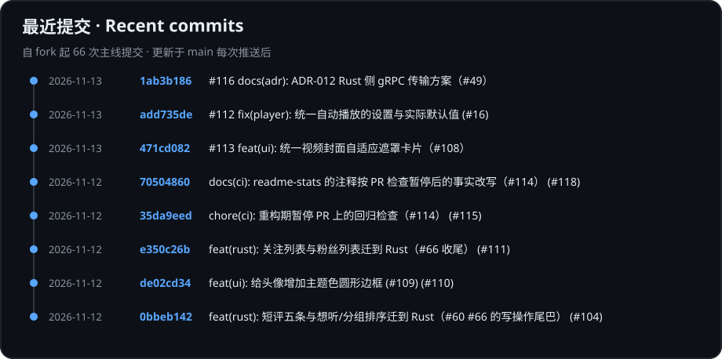
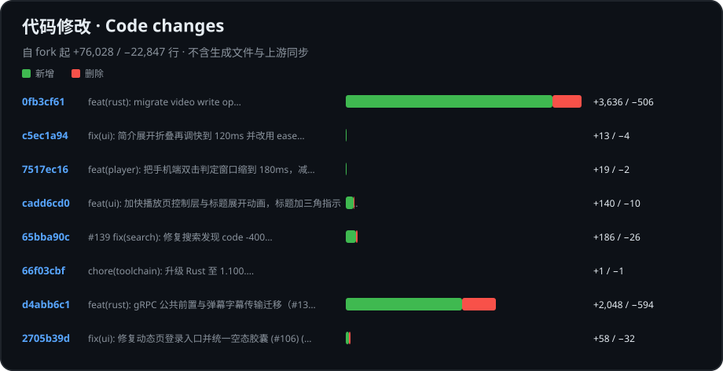

# KiliKili

**Five platforms · A third-party Bilibili client with its core rebuilt in Rust**

[简体中文](README.md) · [English](README.en.md) · [Download](https://github.com/kakakakacat/KiliKili/releases) · [Feedback](https://github.com/kakakakacat/KiliKili/issues)

KiliKili is forked from [PiliPlus](https://github.com/bggRGjQaUbCoE/PiliPlus) and inherits its full feature set and user experience.

## What we're doing

On top of PiliPlus, we are **rebuilding the data and logic layers in Rust** to improve performance and fix long-standing problems wherever we can. The UI layer stays as it is for now.

Later on, we plan to rewrite the UI layer with a Rust UI framework or each platform's native code, so every platform gets the best possible experience.

## Platforms

| Platform | Status |
| :--- | :---: |
| Android | ✅ |
| iPhone / iPad | ✅ |
| macOS | ✅ |
| Windows | ✅ |
| Linux | ✅ |

Platform support comes from PiliPlus. Official KiliKili builds are not yet available; watch [Releases](https://github.com/kakakakacat/KiliKili/releases).

## Project activity

These charts are generated from the `main` branch and update after every push.

Statistics start at the fork baseline. Line counts include source code only, excluding generated files and upstream syncs. GitHub Actions keeps the charts updated.

## Long-term maintenance

**We commit to updating KiliKili for the long term.** We will keep following upstream fixes, API changes and platform compatibility issues. If something feels off or you hit a bug, tell us in [Issues](https://github.com/kakakakacat/KiliKili/issues).

> Want to contribute? Working conventions are in [AGENTS.md](AGENTS.md); design documents live in [`docs/`](docs/).

Thanks to [PiliPlus](https://github.com/bggRGjQaUbCoE/PiliPlus), [PiliPalaX](https://github.com/orz12/PiliPalaX), [PiliPala](https://github.com/guozhigq/pilipala), and all contributors. KiliKili follows [GPL-3.0](LICENSE) and is an independently maintained, unofficial client.
