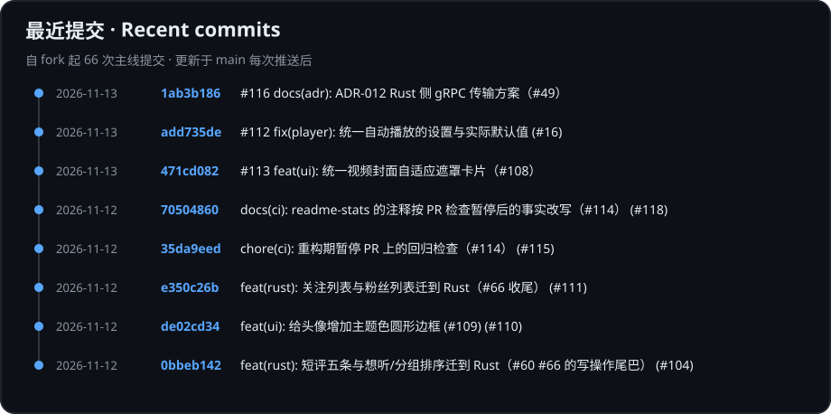
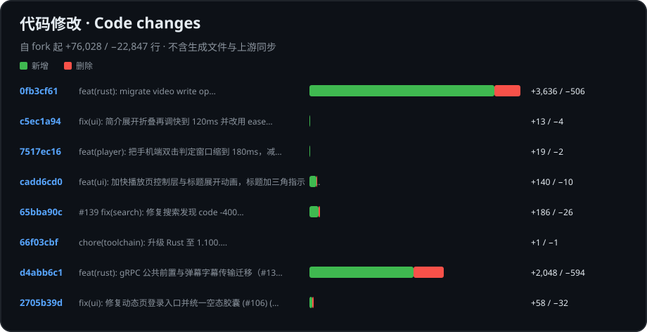

# KiliKili

**五端覆盖 · 用 Rust 重构核心的哔哩哔哩第三方客户端**

[简体中文](README.md) · [English](README.en.md) · [下载](https://github.com/kakakakacat/KiliKili/releases) · [反馈](https://github.com/kakakakacat/KiliKili/issues)

KiliKili fork 自 [PiliPlus](https://github.com/bggRGjQaUbCoE/PiliPlus)，继承了它完整的功能与使用体验。

## 我们在做什么

在 PiliPlus 的基础上，我们正在**用 Rust 重构数据层与逻辑层**，尽可能提升性能、修复既有问题；界面层暂时保持不变。

后续会考虑用 Rust 的界面框架或各平台的原生代码重写 UI 层，让每个平台都获得最佳体验。

## 支持平台

| 平台 | 状态 |
| :--- | :---: |
| Android | ✅ |
| iPhone / iPad | ✅ |
| macOS | ✅ |
| Windows | ✅ |
| Linux | ✅ |

平台支持继承自 PiliPlus；KiliKili 正式安装包尚未发布，请关注 [Releases](https://github.com/kakakakacat/KiliKili/releases)。

## 项目动态

下图根据本仓库 `main` 分支的提交记录自动生成，在每次推送后更新。

统计从 fork 基线开始；代码行数仅计源码，排除生成文件和上游同步提交。图表由 GitHub Actions 自动更新。

## 长期维护

**我们承诺长期更新 KiliKili。** 会持续跟进上游修复、接口变化与平台兼容问题。用着不顺手或者发现 bug，欢迎在 [Issues](https://github.com/kakakakacat/KiliKili/issues) 告诉我们。

> 想参与开发？工作约定见 [AGENTS.md](AGENTS.md)，设计文档在 [`docs/`](docs/)。

感谢 [PiliPlus](https://github.com/bggRGjQaUbCoE/PiliPlus)、[PiliPalaX](https://github.com/orz12/PiliPalaX)、[PiliPala](https://github.com/guozhigq/pilipala) 和所有贡献者。本项目遵循 [GPL-3.0](LICENSE)，是独立维护的非官方客户端。
