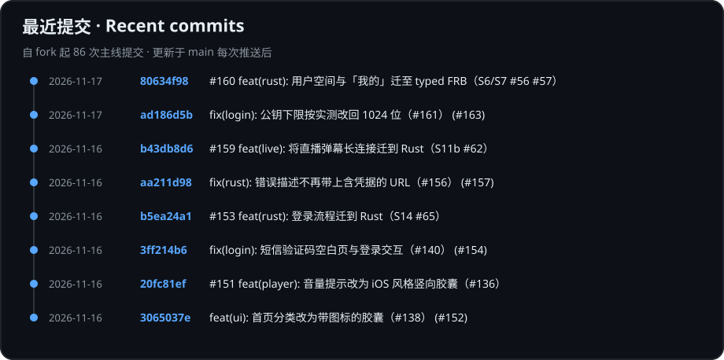

# KiliKili

**更快、更稳的哔哩哔哩第三方客户端**

Android · iPhone / iPad · macOS · Windows · Linux

[简体中文](README.md) · [English](README.en.md) · [下载](https://github.com/kakakakacat/KiliKili/releases) · [反馈](https://github.com/kakakakacat/KiliKili/issues)

KiliKili 基于 [PiliPlus](https://github.com/bggRGjQaUbCoE/PiliPlus)，保留它的全部功能，并用 Rust 重写核心，让它更快、更稳。

  
  
  
  

## 即将到来

- **Liquid Glass 玻璃界面**：首页导航已经用上了，之后会扩展到更多界面。
- **视频补帧**：让低帧率视频播放更顺滑，可随时关闭。

正式安装包尚未发布，请关注 [Releases](https://github.com/kakakakacat/KiliKili/releases)。

## 项目动态

## 长期维护

我们会长期更新 KiliKili。遇到问题欢迎在 [Issues](https://github.com/kakakakacat/KiliKili/issues) 反馈。

感谢 [PiliPlus](https://github.com/bggRGjQaUbCoE/PiliPlus)、[PiliPalaX](https://github.com/orz12/PiliPalaX)、[PiliPala](https://github.com/guozhigq/pilipala) 和所有贡献者。本项目遵循 [GPL-3.0](LICENSE)，是非官方客户端。
