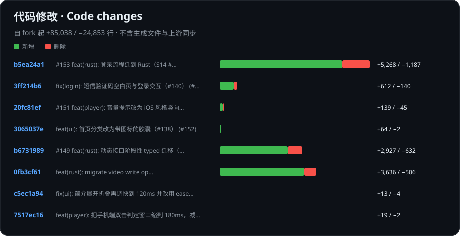

# KiliKili

**五端覆盖 · 用 Rust 重构核心的哔哩哔哩第三方客户端**

[简体中文](README.md) · [English](README.en.md) · [下载](https://github.com/kakakakacat/KiliKili/releases) · [反馈](https://github.com/kakakakacat/KiliKili/issues)

KiliKili fork 自 [PiliPlus](https://github.com/bggRGjQaUbCoE/PiliPlus)，继承了它完整的功能与使用体验。

## 我们在做什么

在 PiliPlus 的基础上，我们正在**用 Rust 重构数据层与逻辑层**，尽可能提升性能、修复既有问题；界面层暂时保持不变。

后续会考虑用 Rust 的界面框架或各平台的原生代码重写 UI 层，让每个平台都获得最佳体验。

## 运行截图

| | 首页（玻璃胶囊导航） | 视频播放页 |
| :---: | :---: | :---: |
| **iOS** |  |  |
| **Android** |  |  |

当前开发版（2026-11）真机截图：iPhone 16 Pro Max · Android 测试机。

## 即将到来

### 跨平台 Liquid Glass

首页底部导航已经换成玻璃胶囊（上图），目前在 Flutter 上实现了胶囊形边缘折射和高光。下一步要把材质做成一套**用 Rust + wgpu/WGSL 编写的共享玻璃引擎**，五端共用同一份材质参数和 Shader，不依赖各平台自带的玻璃组件：

- 实时背景模糊、半透明材质、边缘折射、Fresnel 反射与高光；
- 按压、拖动时的形变，以及组件靠近时的融合效果；
- 按设备性能分为高、中、低三档，低端机自动降级，保证文字始终清晰可读。

进度见 [#130](https://github.com/kakakakacat/KiliKili/issues/130)。

### 视频补帧

为点播加入 **GPU 视频插帧**，把 24/30 fps 的片源补到更高帧率，在高刷屏上播放更顺滑：

- 可选**关闭 / 45 FPS / 60 FPS / 跟随屏幕刷新率**，默认关闭；
- 先在 Android 和 iOS 上验证 720p、30 → 60 fps，再扩展到 Windows、macOS 和 Linux；
- 弹幕和控件在补帧之后叠加，不会被插值糊掉；拖动、倍速、切清晰度后保持音画同步；遇到转场或设备发热时自动回退到原帧率。

进度见 [#211](https://github.com/kakakakacat/KiliKili/issues/211)。

> 两项目前都在预研阶段，最终效果和支持的机型以真机实测为准。

## 支持平台

| 平台 | 状态 |
| :--- | :---: |
| Android | ✅ |
| iPhone / iPad | ✅ |
| macOS | ✅ |
| Windows | ✅ |
| Linux | ✅ |

平台支持继承自 PiliPlus；KiliKili 正式安装包尚未发布，请关注 [Releases](https://github.com/kakakakacat/KiliKili/releases)。

## 项目动态

下图根据本仓库 `main` 分支的提交记录自动生成，在每次推送后更新。

统计从 fork 基线开始；代码行数仅计源码，排除生成文件和上游同步提交。图表由 GitHub Actions 自动更新。

## 长期维护

**我们承诺长期更新 KiliKili。** 会持续跟进上游修复、接口变化与平台兼容问题。用着不顺手或者发现 bug，欢迎在 [Issues](https://github.com/kakakakacat/KiliKili/issues) 告诉我们。

> 想参与开发？工作约定见 [AGENTS.md](AGENTS.md)，设计文档在 [`docs/`](docs/)。

感谢 [PiliPlus](https://github.com/bggRGjQaUbCoE/PiliPlus)、[PiliPalaX](https://github.com/orz12/PiliPalaX)、[PiliPala](https://github.com/guozhigq/pilipala) 和所有贡献者。本项目遵循 [GPL-3.0](LICENSE)，是独立维护的非官方客户端。
