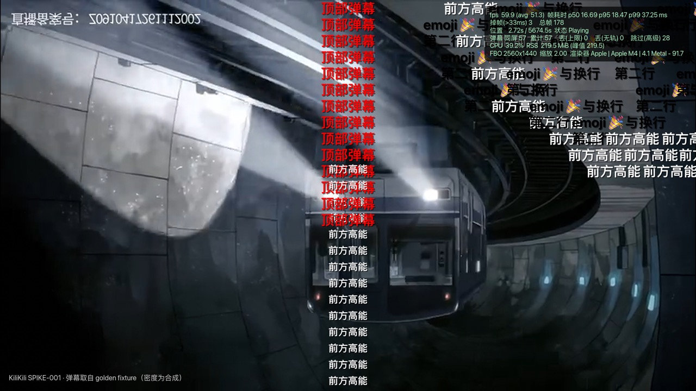
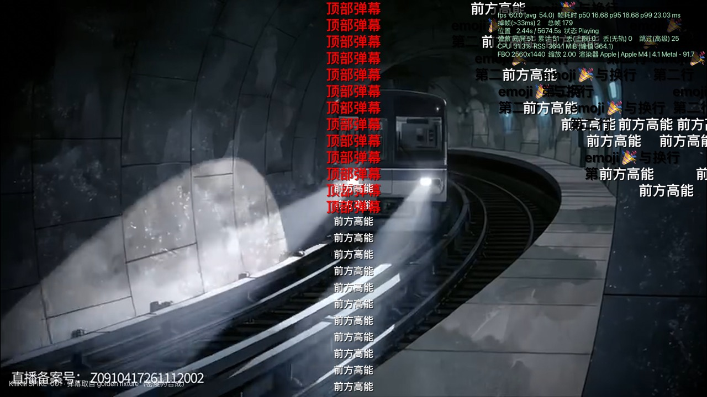

# SPIKE-001 macOS 这一跑：人看出来的结论（issue #8）

配套的机器记录是 [SPIKE-001-macos.md](SPIKE-001-macos.md)，实验台是
[`spikes/slint-mpv`](../../../spikes/slint-mpv)。那份由程序整份覆盖，
这份放它判不了的人工项、要额外盯的三件事，以及这一跑撞出来的两个实验台 bug。

机器：Apple M4 / 32 GiB / macOS 27.3，libmpv 来自 `brew install mpv`
（client API 2.6）。片源是一条公开视频的真实 DASH 取流（852x480 H.264 +
AAC 分轨，**未登录，所以最高 480p**），弹幕形状取自 golden fixture、密度合成
30 条/秒。

---

## 0. 结论

**视频合成与覆盖这一项在 macOS 上 PASS。** 自动项全过（58.0 fps、帧耗时
p95 19.98ms、暂停冻结、SeekCompleted 是事实事件、旧代际被丢弃、硬解、DASH
分轨），人工项全过（下表）。

它不代表 Phase 2 可以走——SPIKE-PLAN 的门槛还有 #10、#11。

## 1. 人工项

| 项 | 结论 | 依据 |
|---|---|---|
| 层级 | PASS | 6 张截图里都是视频在下、弹幕在上、HUD 在最上，弹幕没有被视频盖住 |
| 画面 | PASS（**要 `--flip-y`**） | 不加时上下颠倒，见 §2.1；加了之后颜色、方向、比例都对，缩放与全屏后比例不变 |
| HiDPI | PASS | 三种尺寸下 FBO 都是逻辑尺寸 ×2：1280x720 → 2560x1440、960x540 → 1920x1080、全屏 3024x1898；弹幕与 HUD 文字边缘锐利 |
| 音画同步 | PASS | 仓库所有者在本机手动模式下听了约半分钟，声音与画面对得上 |
| 暂停 | PASS | 自动项：1.4 秒内位置不变（4440ms → 4440ms）；截图里弹幕同时静止 |
| Seek | PASS | 跳到 30s 后 2 秒的截图里，滚动弹幕都是刚从右侧进场的新一批，没有残留 |

## 2. 要额外盯的三件事（Windows 上问不出来的）

### 2.1 FBO 方向：macOS 也要 `--flip-y`

不加时画面天在下、地在上（片源左上角的备案号水印跑到了左下角，字是倒的）：

加了之后：

**三个平台现在是一致的**：Windows + femtovg（dryrun）、Android 真机
（SPIKE-002 §2）、macOS 都需要翻转。Phase 2 的适配器不需要按平台分支，
把 `flip_y = true` 当默认值即可；真遇到不翻的驱动再加例外。

### 2.2 OpenGL 已废弃：现在能走，但 p95 贴着预算线

renderer 串是 `Apple | Apple M4 | 4.1 Metal - 91.7`——走的是 Apple 在 Metal
上的 GL 4.1 兼容层，不是原生 GL。在 2560x1440 的 FBO 上：

| | 平均 fps | 帧耗时 p95 | CPU（结束时） |
|---|---|---|---|
| 视频 + 弹幕 | 58.0 | 19.98 ms | 36.1% |
| 仅弹幕（同参数、no-video，对照） | 58.2 | 17.76 ms | 27.5% |

视频合成只多出约 2ms 的 p95 和约 9 个点的 CPU，大头是 30 条/秒合成弹幕的
文本渲染。也就是说**这条路在 macOS 上不吃力**，没看到掉色、模糊或拖帧；
但 p95 19.98ms 离 20ms 的判据只差 0.02ms，换更高分辨率的片源或 120Hz 外屏
时余量不够。这不改变 ADR-004 的方向，但 Metal 路线（或 `MPV_RENDER_PARAM_SW_*`）
仍应留作 Apple 拿掉 GL 时的退路，而不是假设 GL 会一直在。

### 2.3 videotoolbox 是零拷贝的

`hwdec-current` 是 `videotoolbox`，**不是** `videotoolbox-copy`。Windows 那次
是 `d3d11va-copy`（每帧多一趟 GPU→CPU→GPU）。所以 #9 里写的「避免每帧 CPU
RGBA 拷贝」在 macOS 上已经天然成立，问题只剩 Windows 一端。

## 3. 这一跑撞出来的两个实验台 bug（已修）

### 3.1 DASH 外挂音轨在 macOS / Linux 上根本没加载

第一轮记录写着「给了音频源但没有音轨——样片本身没有声音」，而片源明明有声音。

原因：实验台用 `set_property_string("audio-files", url)` 设音轨。`audio-files`
是**路径列表**，按平台分隔符拆——Unix 上是 `:`，`https://…` 会被拆碎；
Windows 的分隔符是 `;`，而且 dryrun 用的是本地文件，所以那边没暴露。改成
`change-list audio-files append <url>`（只追加一项、不拆分）后第二轮解出 aac。

失败的样子像结论：记录会写「样片没有声音」，而不是「音轨没加载」。生产代码
里没有用 `audio-files`（`lib/`、`rust/` 都搜过），只影响实验台；但 Phase 2
的 `NativeMpvAdapter` 要是照这里抄，会在 macOS 上悄悄丢声音。

### 3.2 实验记录会把带签名的取流 URL 原样写进仓库

记录的「命令行」与「视频源」两处都原样写 URL，B 站取流地址的查询串里带着
签名、时效和客户端 IP（`upsig=`、`oi=`）。原来只靠操作说明里一句「别粘上去」，
而实验台自己就会写进去。现在 `spike-harness` 写记录时统一去掉 URL 的查询串
（主机与路径保留），和主目录脱敏同一处处理，带单测。

## 4. 没覆盖的

- **只到 480p。** 未登录拿不到更高清晰度；1080p/4K 下 p95 是否还在 20ms 内
  没量。§2.2 的余量判断就是因此留的。
- **合成弹幕里多行的那条会压到下一条轨道**（`第二行` 与下一条重叠，截图里
  看得到）。看起来是轨道高度按单行算，没查证；这是弹幕层的排布问题，与视频合成无关，留给
  Phase 2 的弹幕渲染一起处理。
