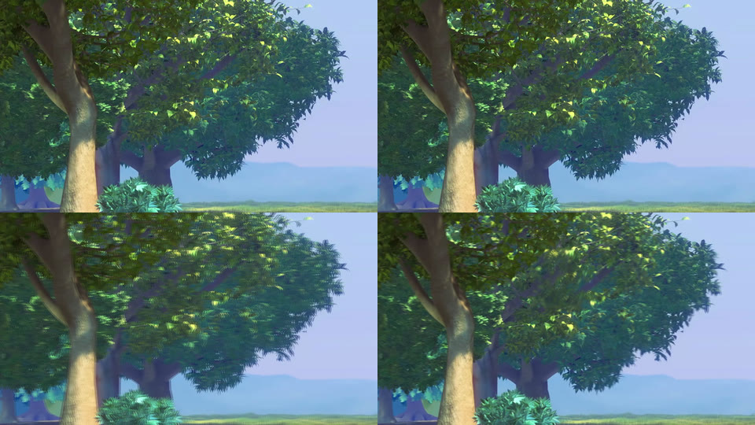

# #218 插帧 spike：插入点、源帧识别与 GLSL 块匹配原型

日期 2026-11-24。手写记录（理由同 #210 补测：Android / iOS 入口是 App；这里汇总的是
macOS 实验室模式、macOS 实时播放、Android 与 iOS 真机几类运行，逐次的 `--record` 产出只留在本机）。
父 issue #211，本 issue #218。

- **代码**：`spikes/slint-mpv/src/interp/`（`gpu.rs` GPU 侧、`sched.rs` 选帧、`shaders.rs`
  着色器、`app.rs` 播放循环与实验室模式）。桌面入口 `src/bin/interp.rs`，Android 入口
  `src/interp_android.rs`（`--features interp`），驱动 `interp-android.sh`。iOS 实验台用
  `#[path]` 原样复用 `gpu.rs` / `sched.rs` / `shaders.rs`（`spikes/slint-ios/src/interp.rs`）。
  **#219 起这三个文件移到了 `rust/crates/player-interp`**，两个实验台都改成依赖那个 crate；
  下文的路径是 #218 当时的位置。
- **macOS**：Apple M4，macOS 27.3，GL 4.1 on Metal，`hwdec=videotoolbox`。
- **Android**：低端机 SM6225 / Adreno 610，Android 14，GLES 3.2，屏幕 640×960、60 Hz，
  `hwdec=mediacodec`（零拷贝）。与 #210 补测是同一台。
- **iOS**：iPhone 16 Pro Max（A18 Pro），iOS 27.3，`spikes/slint-ios` gl 模式（mpv GLES → IOSurface →
  Metal → Slint，`hwdec=videotoolbox` + `hwdec-image-format=bgra`），GLES 3.0。
- **素材**：Blender 基金会的 *Big Buck Bunny*（© Blender Foundation，CC-BY 3.0）1080p **60 fps**
  原片，缩到 720p。60 fps 原片就是真值：用第 k−1、k+1 帧插出第 k 帧，与原片第 k 帧比。
  播放用的 30 / 24 fps 片源由同一原片抽帧得到；「一拍二」片源是先抽到 12 fps 再复制成 24 fps。
  素材不进仓库，取法见文末。

## 0. 结论

#218 要回答的两个问题：

1. **每张源帧能准确识别并带上时间戳。** 每个 vsync 调 `mpv_render_context_update`，有
   `MPV_RENDER_UPDATE_FRAME` 就用 `MPV_RENDER_PARAM_NEXT_FRAME_INFO` 取 `target_time`，再让 mpv
   画进我们自己的纹理。源帧间隔实测 p50 33.33 ms（30 fps）、p95 33.4 ms；seek 与循环回片头
   都能从时间戳的倒退或跳变识别出来（flush）。**但有两个和文档不一样的地方**（§1）：
   `target_time` 实际单位是纳秒；以及 mpv 最多只提前交出一张帧，所以双向插帧必须把画面
   推迟一个源帧间隔，并用 `audio-delay` 把音频推迟同样多。
2. **在 Adreno 610 上放得下：720p 30→60 实时插帧稳定在 60 fps**（显示间隔 p50 16.7 ms，
   与不插帧的直画路径相同），连续 15 分钟不降频（§4.3）。iOS（A18 Pro）同样跑满，运动估计约 3 ms。运动估计 GPU 4.9 ms（R=4）/ 7.8 ms（R=6），每对源帧做一次；
   输出合成每个 vsync 一次，实验室模式 1.9 ms（实时播放中 Adreno 的 timer 读数波动大，
   tile 架构下会把前面 pass 的执行也算进来，以整体帧率为准）。24→60 也跑满。

另外几条结论：

3. **只用 fragment shader 可行，不需要 compute，也不必先写 Metal 版**：同一份 GLSL（加
   `#version 330 core` 或 `#version 300 es` 头）在 macOS GL 4.1、Android GLES 3.2、iOS GLES 3.0
   上都跑通了；iOS 上插帧结果照常经 IOSurface 零拷贝进 Slint，颜色与方向都对（§6）。
4. **运动补偿明显好于线性混合**：BBB 六段平均 PSNR 43.6 dB 对 41.9 dB，SSIM 0.958 对 0.906；
   高速运动段（470 s）31.6 dB 对 24.2 dB、SSIM 0.937 对 0.667。线性混合在动的地方是重影，
   见下图。
5. **重复帧（一拍二）能可靠检测**，跳过重复帧以后插值能跨两张源帧。代价是前瞻要再加一个
   源帧间隔：24 fps 一拍二要推迟约 90–100 ms。
6. **实现里有三个坑，每个都直接把 Adreno 610 拉到 60 fps 以下**，写进 §5，#219 接入时要避开。



## 1. 插入点与源帧识别

ADR-004 的路径是 mpv 在 Slint 的 `BeforeRendering` 里直接画进 Slint 的 FBO。插帧版改成：

```
mpv_render_context_update 有新帧 → NEXT_FRAME_INFO 取 target_time
  → mpv 画进环里的一个槽（视频原始尺寸 RGBA8）→ 该槽的 1/4 亮度
选帧：t_out = now + 一个显示周期 − delay，找 target_time 夹住它的两张源帧
  → 这一对还没有运动场就估计一次（同一对的多张输出复用）
  → 输出 pass 画进 Slint 的 FBO（letterbox）→ Slint 画 UI
```

**`target_time` 的单位是纳秒。** render.h 说它与 `mpv_get_time_us` 同一单位（微秒）；mpv 0.42
（Homebrew）和 media_kit 给 Android 的 libmpv 实测都是纳秒：直接相减得到几百万毫秒，
除以 1000 之后前瞻余量才落在 0–60 ms。mpv 0.37 把内部时钟改成了 ns，这个字段没跟着换算。
实验台按量级自动判断（`target/1000` 离 `now` 更近就是 ns），记录里写明判到的单位。
Phase 2 的适配器要么同样自适应，要么锁定 libmpv 版本后写死。

**前瞻最多一张，和 `video-timing-offset` 无关。** 它决定新帧最多提前多久交出来，按文档调大
就有更多前瞻。实测不是这样（macOS，30 fps，hold 模式）：

| `video-timing-offset` | 前瞻余量 p50 | 环里晚于 now 的帧数 max | starved（输出时刻没有下一张） |
|---|---|---|---|
| 0.05（默认） | 24.2 ms | 1 | 50.4 % |
| 0.1 | 21.9 ms | 1 | 57.0 % |
| 0.2 | 22.1 ms | 1 | 54.0 % |
| 0.5 | 19.2 ms | 1 | 65.3 % |

mpv 的 VO 线程要等上一张帧到了显示时刻才放下一张，所以手里最多只有「下一张」，余量不到
一个源帧间隔。**双向插帧只能把画面整体推迟**：输出时刻取 `now − delay`，同时把 mpv 的
`audio-delay` 设成同样的值，让音频一起推迟。`delay` ≥ 一个源帧间隔即可：

| delay（30 fps） | pair | starved | early | empty（开播前几帧） |
|---|---|---|---|---|
| 0 | 47.1 % | 50.4 % | — | 2.5 % |
| 34 ms | 97.9 % | — | 0.2 % | 1.9 % |
| 40 ms | 97.2 % | 0.2 % | 0.2 % | 2.5 % |
| 50 ms | 96.8 % | 0.4 % | 0.9 % | 1.9 % |

后面所有测量都用 30 fps 片源 50 ms、24 fps 片源 55 ms；跳过重复帧时用 90–100 ms。
音画同步只能间接证明：mpv 自报的 `avsync` 各组都 ≤ 0.06 ms，但它看不见我们额外的推迟。
需要用摄像头拍屏对拍手，或者用一段带闪光 + 哔声的片源才能实测，留给 #219。

**seek 与循环**：`target_time` 倒退或跳变超过 250 ms 就清空环。Android 上每次 seek 后约 0.6 s
处于 starved（显示的是保持的那一张，不黑屏），然后恢复插值；macOS 上只有几帧。

## 2. 算法与画质

所有尺寸都相对 720p 源：亮度降到 1/4（320×180），8×8 块，运动场 40×23。

1. **对称块匹配**：向量定义在插值帧的网格上，中间帧的点 `x` 对应 A 上的 `x − h`、B 上的
   `x + h`。补偿时没有空洞，一次估计就够，不需要前向和后向各估一次。
2. **代价表**：每个（块，候选向量）一个 fragment 算 SAD，输出 (fw·D)×(fh·D)，D = 2R+1。
   SAD 按棋盘格隔点取样，每块 16 点。
3. **argmin + 亚像素**：每块取最小，再做半像素、四分之一像素两层细化（双线性采样）。
4. **3×3 分量中值**去掉孤立的错配块。
5. **全帧统计**：一个 fragment 扫完运动场，得到失配均值（判转场）和变化块占比（判重复帧）。
6. **输出**：按相位 p 从 A、B 各取补偿后的像素混合；全帧失配超过阈值就当转场，显示最近的
   那张源帧；局部失配很大时退回线性混合。

### 2.1 画质（实验室模式，BBB 六段 × 10 张，与 60 fps 真值比）

最终参数 R=6（Android 用 R=4，结果几乎相同），亚像素两层，SAD 隔点：

| 段 | hold（前一张） | 线性混合 | 运动补偿 |
|---|---|---|---|
| 75 s | 50.94 dB / 0.9967 | 54.45 / 0.9979 | **55.29 / 0.9984** |
| 140 s | 32.10 / 0.9787 | 35.39 / 0.9845 | **36.39 / 0.9870** |
| 200 s | 21.98 / 0.7397 | 25.48 / 0.7858 | **26.47 / 0.8275** |
| 290 s | 54.12 / 0.9995 | 55.87 / 0.9997 | 55.87 / 0.9997 |
| 380 s | 53.16 / 0.9991 | 56.19 / 0.9995 | 56.19 / 0.9995 |
| 470 s | 22.28 / 0.6201 | 24.18 / 0.6673 | **31.64 / 0.9367** |
| **平均** | 39.10 / 0.8890 | 41.93 / 0.9058 | **43.64 / 0.9581** |

（PSNR dB / SSIM。290、380 两段几乎静止，向量全为零，运动补偿退化成线性混合，两列相同。）

### 2.2 参数怎么定的

在同一套六段上扫过（SSIM 平均）：

| 改动 | SSIM | 结论 |
|---|---|---|
| 无亚像素 | 0.907 | 和线性混合差不多：整像素向量（低分辨率下是 4 源像素）对细节太粗 |
| 半像素 | 0.938 | |
| 四分之一像素 | 0.941 | 默认 |
| SAD 隔点（16 点）| 0.941 | 几乎不掉画质，代价表耗时减半；默认 |
| R=4 / 6 / 10 | 0.937 / 0.938 / 0.937 | BBB 的运动在 R=4 之内。R 决定每帧最大位移 2·R·4 源像素：R=4 是 32 px、R=6 是 48 px |
| λ（向量长度惩罚）0 / 0.002 / 0.01 | 0.937 / 0.938 / 0.936 | 影响很小 |
| 局部失配退回最近源帧，阈值 0.06–0.15（第一版） | 0.941 | PSNR 41.5 dB，反而低于线性混合 |
| 退回最近源帧，阈值放宽到 0.10–0.25 | 0.951 | |
| 退回线性混合，阈值 0.25–0.5 | 0.958 | 默认。完全不回退是 0.959，留一点保护 |

第一版的局部回退阈值很严，纹理区大面积退回到最近源帧，PSNR 反而比线性混合低。阈值放宽、
回退目标改成线性混合之后，运动补偿在每一段都不差于线性混合。

**还没测的画质**：真实番剧（平涂 + 细线 + 画面字幕）、快切、大位移（> 48 px/帧）。BBB 是 3D
动画，纹理和运动模糊都比番剧多。#219 的真机验收要用 B 站番剧素材再跑一遍实验室模式，
`--lab` 接受任意 60 fps PNG 序列。

## 3. 重复帧（一拍二 / 一拍三）

判定方法：每块的零运动 SAD 超过 0.01（约 2.5 个色阶）就算这一块「变了」，全帧变化块
占比 < 0.15 %（约 1 个块）就判为重复帧。

| 片源（macOS，各约 340 对） | 变化块占比 p5 / p25 / p50 / p95 | 判为重复 |
|---|---|---|
| BBB 24 fps | 0.0022 / 0.038 / 0.109 / 0.997 | 49 对（14 %，静止镜头） |
| BBB 24 fps 一拍二 | 0 / 0 / 0 / 0.95 | 190 对（55 %） |

静止镜头被判成重复也没有关系，前后两张本来就一样。打开 `--skip-dups` 后，选帧时跳过
已判定的重复帧，一拍二的 `X X Y Y` 就按 `X _ Y _` 插值：

| 平台 | delay | 输出帧所在的源帧对跨度：1 / 2 / 3 张 |
|---|---|---|
| macOS | 90 ms | 26 % / 72 % / 2 % |
| Android | 100 ms | 65 % / 30 % / 6 % |

Android 上跨两张的比例低，原因是重复帧的判定要先在 GPU 上算、再异步回读，有一部分到得
比用到它的时刻晚。要提高比例，可以把 delay 再加大，或者在收帧时就提前算好这一对的统计
（现在要等这一对第一次被选中才算）。**连续 3 张以上的重复不跳**：否则静止镜头结束后的第一
张新画面会和很久以前的那张配对，插出一段慢动作。

一拍二真正的画质（应该和 12→60 插帧相当）没有 60 fps 真值可比，需要用真实番剧人眼看，
留给 #219。

## 4. 开销

### 4.1 Adreno 610 实验室模式（GPU timer，单位 ms，p50）

| | 代价表 | argmin + 亚像素 | 中值 | 统计 | **运动估计合计** |
|---|---|---|---|---|---|
| 第一版（uniform 循环边界、循环里整数除法） | 14.99 | 13.72 | 0.05 | 0.28 | 29.0 |
| 常量化（`#define R / D / STEP`）R=6 | 5.52 | 4.65 | 0.05 | 0.27 | 10.5 |
| 常量化 R=4 | 2.62 | 3.31 | 0.05 | 0.27 | **6.2** |
| 常量化 R=4、半像素 | 2.62 | 2.33 | 0.04 | 0.27 | 5.3 |

亮度降采样每张源帧 0.8 ms。M4 上同样的运动估计墙钟 p50 1.2–1.6 ms。

### 4.2 Adreno 610 实时播放（720p，`mediacodec` 零拷贝，20 s）

| 组 | 显示间隔 p50 / p95 | 输出帧 / 20 s | 运动估计 GPU p50 | pair |
|---|---|---|---|---|
| direct（ADR-004 原路径，不插帧） | 16.78 / 22.38 ms | 1179 | — | — |
| hold（走纹理环，不插帧） | 16.68 / 22.19 | 1180 | — | 97.6 % |
| **mc 30→60，R=4** | **16.69 / 23.44** | **1177** | 4.91 | 98.0 % |
| mc 30→60，R=6 | 16.67 / 23.01 | 1177 | 7.80 | 98.0 % |
| mc 24→60，R=4 | 16.48 / 22.77 | 1178 | 5.12 | 98.1 % |
| mc 24 一拍二 + 跳重复，R=4 | 16.63 / 22.55 | 1183 | 5.06 | 98.1 % |

mc 组插帧代码在 CPU 上的耗时 p50 1.9 ms，其中回读 0.07 ms。

### 4.3 连续播放 15 分钟（Adreno 610，mc 30→60，R=4）

BBB 440–500 s 循环播放 900 s（中间回到片头 8 次，flush 8 次）。设备**全程接着电源**，
电池 100 %，室温环境、未加散热：

| | 值 |
|---|---|
| 输出帧 | 52493（平均 58.3 fps） |
| 显示间隔 | p50 16.69 · p95 25.16 · p99 32.59 ms |
| 选帧 | pair 99.9 %，starved 0.1 % |
| 运动估计 GPU | p50 4.77 · p95 6.71 ms（与开头 20 s 的 4.91 / 6.69 一致，没有降频迹象） |
| mpv 丢帧 | 0 |
| 温度（开始 → 结束） | 电池 29.6 → 31.0 ℃；GPU 35.6 → 38.0 ℃；CPU 簇 38.0 → 44.9 ℃ |

功耗没有测（接着电源，读不到放电电流），留给 #219 用电池供电再测一次。

## 5. 三个会把低端机拉到 60 fps 以下的坑

都是在 Adreno 610 上逐个排查出来的。#219 接入时照做即可：

1. **渲染线程不能同步取 mpv 属性。** 第一版每张新帧调两次 `mpv_get_property("dwidth"/"dheight")`，
   hold 模式就从 59 fps 掉到 51 fps：同步取属性要排队等 mpv 的 core 线程，core 忙着解封装或
   解码时渲染线程就跟着干等。改成后台线程每 200 ms 取一次、渲染线程只读原子量，恢复到 59 fps。
   SPIKE-001 的教训（不能从渲染线程发同步的 `mpv_command`）也适用于属性读取。
2. **不能用 `glReadPixels` 把 GPU 结果读回 CPU，哪怕读进 PBO、等 fence 到了再发也不行。**
   运动估计后读 1×1 的统计：直接读，CPU 等 9.5 ms（p50），输出 51 fps；改成等计算的 fence
   到了再发读，还有 p50 3.5 / p95 17 ms，52 fps。Adreno 的驱动让 CPU 等当前整条命令流跑完，
   不管数据是不是早就算好了。**改用 transform feedback**：一个只有 1 个点的 draw，在顶点
   着色器里读统计纹理、写进 buffer，fence 到了再 map。回读段的 CPU 耗时降到 0.07 ms，
   帧率回到 59 fps。GL 3.0+ / GLES 3.0 都有，五端通用。
3. **着色器的循环边界和步长要编译期常量。** 用 uniform 做边界、在循环里做 `y / step` 这种
   整数除法（移动 GPU 上是软件模拟的），运动估计要 29 ms；改成 `#define` 后是 6–10 ms。
   参数变了就重编程序。

还有两个只在 macOS 上撞到的：

- **macOS（GL on Metal）上 `glGenerateMipmap` 对 RGBA16F 是点采样。** 第一版用运动场 mipmap
  的顶层当全帧平均，读出来只有 0 / 1，其实是某一个块的值。改成显式的规约 pass。
- **macOS 上的 GPU timer query 不可信**（大量读数是 0）。Mac 的耗时以实验室模式的
  `glFinish` 墙钟为准。Adreno 的 timer 正常。另外，mpv 自己也用 `GL_TIME_ELAPSED`，所以不能给
  mpv 的渲染调用套计时（嵌套查询会让 mpv 那边报 `INVALID_OPERATION`）。

## 6. iOS（iPhone 16 Pro Max / A18 Pro）

`spikes/slint-ios` 的 gl 模式接上了插帧路径（`SPIKE_INTERP=mc` 等，见那边 `src/lib.rs` 开头）：
mpv 的新帧画进纹理环，每个 8 ms tick 插一张，画进 IOSurface 零拷贝目标，后面的 Slint / PiP
路径不变。GPU 侧是 slint-mpv 那份 `gpu.rs` / `sched.rs` / `shaders.rs` 原样引用，GLES 3.0 上
RGBA16F 渲染、transform feedback 回读都能用。渲染器报 `Apple A18 Pro GPU / OpenGL ES 3.0 Metal`。

720p，每组约 30 s，取稳态的每秒 HUD 行：

| 组 | UI fps | 插帧输出 / s | 每张输出的 CPU 耗时 p50 / p95 | 运动估计（含 glFinish） p50 / p95 | pair | CPU |
|---|---|---|---|---|---|---|
| 原路径（不插帧） | 60.7 | 29.9（源帧） | 1.10 / 1.40 ms | — | — | 44 % |
| hold | 60.7 | 120 | 0.53 / 1.2 ms | — | 100 % | 48 % |
| **mc 30→60** | 60.6 | 120 | 0.75 / 1.3 ms | — | 100 % | 51 % |
| mc 30→60，量运动估计 | 60.6 | 118 | 2.0 / 4.0 ms | 2.9 / 4.3 ms | 100 % | 54 % |
| mc 24→60，量运动估计 | 60.7 | 117 | 0.55 / 4.5 ms | 2.8 / 3.6 ms | 100 % | 50 % |

（iOS 的 GLES 没有 timer query，运动估计只能前后各 `glFinish` 量墙钟，会把 CPU 也拖慢，所以
单独一组。）真机截图确认画面方向、颜色正常（BGRA，不偏绿），弹幕叠在插帧画面之上。

**一个要在 #219 解决的问题**：插帧输出跟着 8 ms 定时器走，每秒算 120 张，但 Slint 在 iPhone 上
只以 60 fps 重绘（ProMotion 没在 Info.plist 里打开），一半输出白算了；定时器也不和 vsync 对齐。
正式接入要由 CADisplayLink（或 Slint 的渲染回调）驱动，每次显示刷新只算一张。

## 7. 留给 #219 的输入

- 接入形态：`Gpu` + `Ring` 这一套可以直接长成 `NativeMpvAdapter` 里的一层。Android 的
  Choreographer 时间戳、iOS 的 CADisplayLink 还没接，现在的输出时刻用的是「now + 一个显示
  周期的滑动平均」（iOS 是 8 ms 定时器，见 §6）。
- 默认参数：低端机 R=4、亚像素两层、SAD 隔点、delay = 一个源帧间隔 + 约 15 ms；高端机可以 R=6。
- 片源帧率达到或超过目标帧率时直接走 direct，不进环。
- 要补测的：电池供电下的功耗、iOS 连续 15 分钟与发热、音画同步实测（拍屏）、真实番剧画质、快切与画面字幕伪影、倍速（倍速下源帧间隔
  会变，选帧逻辑本身不依赖固定帧率，但没测过）、PiP 时回退到原帧率。

## 复现

```sh
# 素材（不进仓库）
curl -LO https://download.blender.org/demo/movies/BBB/bbb_sunflower_1080p_60fps_normal.mp4.zip && unzip bbb_*.zip
SRC=bbb_sunflower_1080p_60fps_normal.mp4
ffmpeg -ss 440 -t 60 -i $SRC -vf "scale=1280:720:flags=lanczos,fps=30" -c:v libx264 -crf 16 -c:a aac bbb30.mp4
ffmpeg -ss 470 -i $SRC -vf scale=1280:720:flags=lanczos -frames:v 21 lab470/f%04d.png   # 实验室真值

cd spikes/slint-mpv
cargo run --release --bin interp -- --lab lab470 --lab-out lab470/out        # 写 hold/blend/mc-fNNNN.png
cargo run --release --bin interp -- --video bbb30.mp4 --mode mc --flip-y --delay-ms 50 --duration 20 --record rec.md

# Android（环境变量同 README「构建与运行」）
cargo apk build --release --lib --features interp && adb install -r target/release/apk/slint_mpv_spike.apk
./interp-android.sh --push bbb30.mp4 -- --video bbb30.mp4 --mode mc --flip-y --hwdec mediacodec \
    --duration 20 --delay-ms 50 --radius 4 --record rec.md
```

PSNR / SSIM 用 ffmpeg 的 `psnr` 与 `ssim` 滤镜逐张对真值算，取均值。
