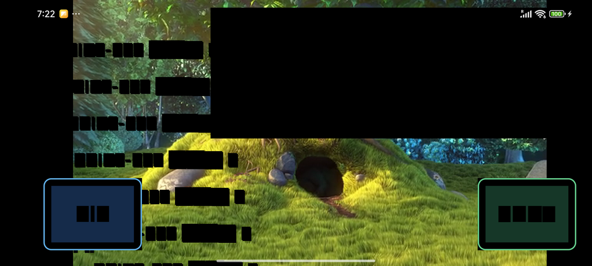
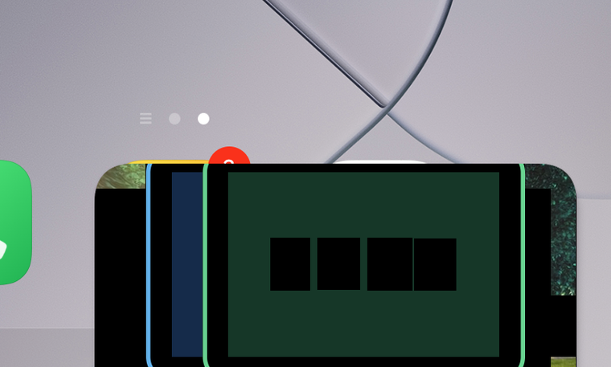
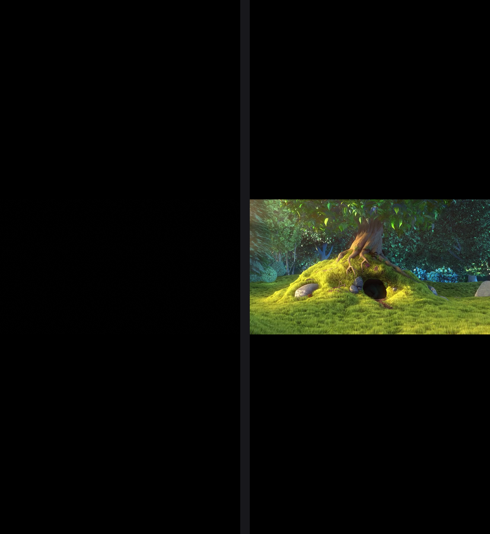
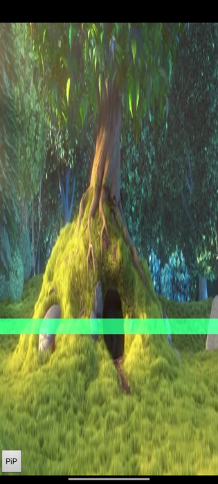

# SPIKE-002 · Android：Slint 视频表面与 libmpv

状态：**#9 的全部范围已答，PASS——但带着一条要记进 Phase 2 的代价**
对应 issue：[#9](https://github.com/kakakakacat/KiliKili/issues/9)
日期：2026-11-21（分两轮，同一天）
设备：小米 13 Ultra（2304FPN6DC）/ Android 14 / Adreno 740 / arm64-v8a，真机实跑

这份是**手写**记录，不是 `--record` 自动产出的那种（那条路是桌面实验台的，
Android 上没有命令行，入口是 `android_main`）。证据来自 logcat、mpv 自己的
日志、帧缓冲回读与系统截图。

## 两轮分别问了什么

- **第一轮**（PR #185）只问前提：Android 上 Slint 的渲染回调给不给 OpenGL
  上下文、libmpv 能不能把视频画进同一个 framebuffer。它若不成立，#9 的答案
  直接翻到 SurfaceView／纹理合成那条路，后面那些项要重新设计才谈得上。
- **第二轮**（本次）补 issue 范围里剩下的全部：触摸分发、旋转、surface
  生命周期、后台音频、PiP，以及 Media3 的回退对照
  （`spikes/media3-probe`，单独一个 Kotlin 工程）。

第二轮全部用脚本驱动（`spikes/slint-mpv/android-drive.sh`）：系统那边做一个
动作、探针这边记一条事实，两边时间戳对得上。人只负责看截图确认画面。

## 一张表看完

| #9 的项 | 结果 | 证据 |
|---|---|---|
| Slint 的渲染回调给不给 GL 上下文 | **给** | `SURFACE setup #1：给到 GraphicsAPI::NativeOpenGL` |
| 是真 GPU 还是软渲染 | **真 GPU** | `Qualcomm \| Adreno (TM) 740 \| OpenGL ES 3.2 V@0676.32` |
| mpv 能否画进 Slint 的同一个 FBO | **能，画面正确** | 帧缓冲回读与系统截图一致 |
| 避免每帧 CPU 拷贝（#9 标粗那条） | **能，要两个前提** | `hwdec-current=mediacodec`（非 `-copy`） |
| **触摸分发** | **能，按钮与画面层分得开** | `TOUCH click 目标=PiP 按钮` vs `TOUCH down 目标=画面层`；一次滑动 `move=37` |
| **旋转**（声明 configChanges） | **不重建 activity，surface 原地 resize，画面继续** | `SIZE 1116x2480 -> 2364x1116`，无 teardown，`drop=0` |
| **旋转**（不声明，对照包） | **activity 被销毁重建**，mpv 实例跟着重来，进度归零 | `EV Main(Destroy)` + `android_main 第 2 次`（pid 不变） |
| **surface 生命周期** | teardown/setup **成对**，render context 能反复重建 | 连续三次 `SURFACE mpv render context 已建立（第 N 次）` |
| **后台音频** | **继续播**，位置不丢 | 后台 12 秒里 `STATUS` 的 `t` / `audio-pts` 一直在走 |
| **回前台的画面** | **回不来**（`hwdec=mediacodec` 时），要走恢复配方 | 回读图全黑 vs 配方之后有画面 |
| **PiP 可行性** | **能**，UI 线程/别的线程都能调，自动进入也行，小窗里继续渲染 | `PIP enter(...) = true`、`isInPictureInPictureMode=true`、小窗尺寸 617x347 的回读 |


图是**进程内读回 FBO** 的结果（`glReadPixels`），不是系统截图——它量的是
「我们这一层画成了什么」，中间不隔 SurfaceFlinger。同一时刻的
`adb exec-out screencap` 与它一致，说明这一层的结果原样到了屏幕。

## 逐项的做法与结论

### 触摸分发

探针在视频之上摆了三样东西：铺满窗口的 `TouchArea`、两个按钮。点按钮时只有
按钮的 `clicked` 响应，点别处只有那层 `TouchArea` 响应，滑动能出几十条
`move`。**视频不在元素树里**（它是 `BeforeRendering` 时画进同一个 FBO 的），
所以「视频会不会把触摸吃掉」这一问的答案就是：不会，命中测试照常工作。

Phase 2 的进度条/亮度手势因此有基础。顺带踩到一个与结论无关的坑：按钮宽度
按逻辑像素写死 240px，而手机竖屏总共才 400 出头，两个按钮在中间叠上了——
后面那个盖住前面那个，`input tap` 点 PiP 点成了 SHOT。**驱动脚本点的坐标要
由布局算出来再回报**（探针的 `BUTTONS` 行），不能在脚本里按常数猜。

### 旋转

两种 manifest 都测了，差别很大：

- **声明 `configChanges`（含 `screenSize|smallestScreenSize|screenLayout`）**：
  转屏只是 `ConfigChanged` + `WindowResized`，**没有** teardown/setup，
  `android_main` 不重跑，mpv 实例、播放进度、硬解档位全部原样，画面随窗口
  变成 2364x1116 继续出帧，丢帧计数仍是 0。
- **不声明（`./android-repack.sh --recreate` 打的对照包）**：
  `TerminateWindow → Stop → Destroy`，然后 **`android_main` 第 2 次**
  （进程不变），mpv 实例重建，**进度归零**。



横屏时视频按比例居中（640x360 的片源在 2364x1116 的窗口里两侧留黑），弹幕层
与两个按钮跟着重新布局。图里文本仍是方块，那是坑 4 说的第一张 surface 的问题。

结论：Phase 2 的 Android activity 必须自己声明这些 configChanges。这不是优化，
是「转一下屏幕播放从头开始」与「无感」的区别。

### surface 生命周期

HOME → 回前台这一轮里，事件顺序每次都一样：

```
Pause → LostFocus → (teardown) → TerminateWindow → Stop
Start → InitWindow → (setup) → WindowResized → GainedFocus
```

`RenderingSetup` 与 `RenderingTeardown` 严格成对，render context 连续重建
三次都成功，GL 字符串每次都是同一块 Adreno 740。也就是说**表面可以死、可以
重来**，这条路不会因为一次切后台就废掉。

代价在下一节：重建之后画面回不来（坑 5）。

### 后台音频

后台 12 秒期间，独立状态线程每秒一条，`t` 与 `audio-pts` 一直在走——**声音
没停**。这里有两件事要分清：

- **不做任何策略时也能继续**，但那是 mpv 自己的行为：render context 一没，
  VO 跟着死，mpv 把视频轨丢掉（`Video: no video`），只剩音频继续。
- **没有音频轨的话，整个文件会被卸掉**。第一轮用的 probe.mp4 没有音轨，
  mpv 日志里是 `EOF code: 6` / `finished playback, video output
  initialization failed (reason 4)`，播放彻底结束，连 `reopen` 都要人来发。

所以「碰巧没死」不能写进契约。探针实现了 ADR-003 的那条策略并验过：
`Main(Pause)` 时下发 `SetLifecycle(Background)`（= `vid=no`），**赶在
teardown 之前生效**（探针会等它落地再销毁 render context），回前台时在新的
render context 建好之后下发 `Foreground`。这样后台是「只剩音频」这件确定的
事，而不是一次运气。

顺带一提，第二轮为此造了一条音轨：probe.mp4 本身没有声音，拿默片测音频等于
没测。`spikes/slint-mpv/make-probe-audio.py` 用标准库合成一条带节拍的 WAV
（本机没有 ffmpeg），探针按 `MediaSource::Dash` 分轨开——跟真实的 B 站取流
是同一条路径。

### PiP 可行性

NativeActivity 这条路上 PiP **够得着**，但每一步都要自己来：

- manifest 里的 `android:supportsPictureInPicture` cargo-apk 生成不出来，
  要打完包换 manifest（`spikes/slint-mpv/android-repack.sh`，脚本开头写了
  为什么）。没有这个属性，`enterPictureInPictureMode` 直接抛异常。
- 调用要走 JNI（NDK 没有对应的 C API）。`enterPictureInPictureMode` 带
  `PictureInPictureParams`（16:9）返回 `true`，**从 UI 线程和从别的线程调都
  成功**——后者本来是存疑的，实测不挑线程。
- `setAutoEnterEnabled(true)`（API 31）也生效：按 HOME 直接变小窗，不用先点
  按钮。视频应用的标配手势成立。
- **进出 PiP 没有回调**：`onPictureInPictureModeChanged` 是 Activity 的方法，
  NativeActivity 这条路上收不到，只能每秒轮询 `isInPictureInPictureMode`。



小窗里窗口变成 617x347，Slint 继续出帧、mpv 继续画（图里小窗左右两侧露出来的
就是视频），`hwdec-current` 仍是 `mediacodec`、丢帧 0。UI 布局在小窗里当然不合适（按钮按逻辑像素算还是那么大，
几乎占满小窗）——那是 Phase 2 的 UI 要按窗口尺寸切换布局，不是这条路的问题。

## 坑（Phase 2 的 Android 适配器会原样踩一遍）

### 1. 零拷贝要先把 JavaVM 交给 FFmpeg，而且退化是静默的

`hwdec=auto-safe` 实测落在 **`mediacodec-copy`** 上——每帧一趟
GPU→CPU→GPU，正是 #9 标粗要避免的那个拷贝。mpv 日志里的因果链：

```
h264_mediacodec: No Java virtual machine has been registered
h264_mediacodec: Both surface and native_window are NULL
Using hardware decoding (mediacodec-copy).
```

**`PlayerPort` 那一侧什么都看不到**：状态照样是 Playing，画面照样出来，只有
mpv 自己的日志里有这三行。所以适配器必须把 `hwdec-current` 读出来上报，
不能假定「要了什么就得到什么」。

两个前提缺一不可：

1. 进程启动时调用 `av_jni_set_java_vm`（符号在 libmpv.so 里，
   JavaVM 指针从 `AndroidApp::vm_as_ptr()` 拿）；
2. **显式要 `hwdec=mediacodec`**——`auto-safe` 不含非 copy 的那一档。

两条都做到之后 `hwdec-current=mediacodec`，mpv 走 `aimagereader` interop。

### 2. 画面是上下颠倒的，Android 要 `flip_y = true`

第一轮按桌面的参数传了 `flip_y = false`，回读出来天在下、地在上。
方向这件事**不能照抄桌面**，每个平台自己验一次。

### 3. Slint 按需重绘，mpv 不会自己出帧

mpv 只在 `BeforeRendering` 里画，而 Slint 没有「每帧都重绘」这回事：UI 不变
就不出帧。第一轮 HUD 每 200ms 更新一次，整条管线就被压到 5fps，看起来像是
mpv 不出帧——实际是没人驱动渲染。适配器必须自己有个帧泵（16ms tick，且
**让画面内容真的变**，否则 Slint 判不脏照样不画）。

### 4. 文本层只在**第一张** surface 上画不对（第一轮的结论要改）

第一轮记的是「弹幕只有黑方块（tofu）、HUD 与水印完全没出现」。第二轮发现这句
话要加一个限定：**只在第一张 surface 上如此**。切一次后台再回来（surface
重建、skia 的 GL 上下文重来一遍）之后，同样的 UI 文本**完全正常**：中文、
HUD、按钮文字全出来了。

也就是说，这不是「Android 上没有字体」，而是**第一次建 surface 时 skia 这边
有什么没初始化好**。Phase 2 查 Android UI 时从这个方向查，别再去翻字体回退。

### 5. surface 重建之后，mediacodec 的画面**回不来**（这一轮最贵的发现）

切后台再回前台，render context 重建成功、mpv 报 `hwdec-current=mediacodec`、
`vid=1`、`drop=0`、进度照走——**但画面是黑的**。用 `shot-pair` 取了一对图
（mpv 刚画完一张、整帧合成完一张）：**两张都黑**，所以不是 Slint 这层盖掉的，
是 mpv 根本没画出内容来。

试过的救法，逐个排除：

| 做法 | 结果 |
|---|---|
| 把视频轨重选一遍（`vid=no` → `auto`） | ❌ 还是黑（试了两次，等几秒再试也一样） |
| 把 `hwdec` 原值再写一遍 | ❌ 还是黑（mpv 对同值写入不重建解码链） |
| `hwdec=no`（换软解） | ✅ **有画面**——问题出在 mediacodec 的 interop，不在别处 |
| `hwdec=no` → 再回 `mediacodec` | ❌ 又黑了 |
| **完整 `loadfile`** | ✅ 有画面，`hwdec-current=mediacodec`，零拷贝也在 |

结论：**render context 重建之后，mediacodec 这条零拷贝路必须靠一次完整重载
才能重新接上**，单纯重建解码器不够。

于是 Phase 2 的恢复配方只能是：

```
记住 time-pos → loadfile（重新 Open + Play）→ seek 回那个位置
```

探针把这条配方实现成了 `recover` 命令并实跑验证：回前台后画面黑着，发一条
`recover`，`recover: 重开并 seek 回 36732ms`，之后回读图里画面回来了，
`t` 从 37 秒继续走，`hwdec-current=mediacodec`、`drop=0`。



左边是回前台之后的帧缓冲回读：UI 都在，视频没了。右边是同一次运行里跑完
`recover` 之后的同一个回读点。两张都是**进程内**读回来的，所以排除了
「是不是系统合成那一层的问题」。

代价要如实记：这是一次真实的重载，**会有一下卡顿**，而且 seek 要等
`loadfile` 完成（探针用了 500ms 的粗暴延时，正式适配器应当等 `FILE_LOADED`
事件）。这条也可能是 libmpv 在这台设备上的 bug，换设备/换 libmpv 版本值得
再验一次——但在它成立的地方，适配器必须有这一步。

### 6. **PiP 也会走 `Pause`**，别把 Pause 当成「进了后台」

后台策略挂在 `Main(Pause)` 上是对的，但进小窗同样触发 `Pause`——不加判断的话
一进 PiP 视频就被自己关掉了。探针的做法是先问一句 `isInPictureInPictureMode`，
真在小窗里就什么都不做。这是这一项里最容易写错的一处。

### 7. 两条与探针无关、但会浪费时间的事

- **锁屏时启动什么都看不到**：activity 不可见 → Slint 不渲染 → 既没有日志也
  没有画面，而进程是活的，看起来像死锁。跑之前
  `adb shell svc power stayon usb`，跑完 `false` 还原。锁屏滑不开时只能人去解锁。
- **logcat 的环形缓冲会把证据冲掉**：第一轮把每条 mpv Snapshot（30ms 一条）
  都打出来，十几秒就把开头那几行结论挤没了。第二轮还撞到另一个版本：
  android-activity 的 `MainEvent` 的 `Debug` 里带着整个 `AndroidApp`，
  一条 `Resume` 就是 1.5KB。现在事件只打变体名。

## Media3 回退对照

对照工程在 `spikes/media3-probe`（Kotlin + Gradle，Media3 1.9.0），阶段与
Slint 那边一一对应：同样的触摸、同样的转屏、同样的 HOME、同样的 PiP，
素材也用同一份 probe.mp4 + probe-audio.wav。

对照组刻意摆了**三层**：底下 `SurfaceView` 放视频，上面一层透明的
`GLSurfaceView`（`setZOrderMediaOverlay(true)` + `PixelFormat.TRANSLUCENT`）当
UI 层的替身，再上面一个普通 `Button`。三层能不能叠住、触摸分不分得开，才是
回退路线成不成立的关键——Media3 能放视频这件事本来就没有悬念。



图里三层都在：视频（被 `MATCH_PARENT` 拉伸了，对照组没做比例适配）、
横贯屏幕的半透明绿条（GL 覆盖层在出帧）、左下角的按钮。

| 维度 | Slint + libmpv（主路） | Media3 + SurfaceView（回退） |
|---|---|---|
| 硬解零拷贝 | 要 `av_jni_set_java_vm` + 显式 `hwdec=mediacodec`，否则**静默**退到 `-copy` | 默认就拿到 `c2.qti.avc.decoder`，不用配置，也没有静默退化 |
| UI 叠加 | 同一个 FBO，一次合成 | 三层 surface/视图，交给 SurfaceFlinger 合成 |
| 触摸分发 | Slint 元素树命中测试 | Android 视图树；SurfaceView 不吃触摸 |
| 旋转 | 声明 configChanges 后不重建 | 同样 |
| 后台音频 | 要自己在 `Pause` 时下发 `vid=no`，且必须赶在表面销毁前 | **框架自己处理**：`onStop` 期间照播 |
| 回前台的画面 | **回不来**，必须完整重载 + seek（坑 5） | 自动恢复，进度不丢 |
| PiP | manifest 要换、调用要走 JNI、进出没有回调只能轮询 | Activity 自带，`onPictureInPictureModeChanged` / `onUserLeaveHint` 都有 |
| 宿主形态 | 全 Rust，换宿主框架时这层不用重写 | 需要一层 Kotlin 的 Activity 与视图树 |

实测的几处细节：

- 后台那一项差得最明显。Media3 这边 HOME 之后 `t` 从 38.7 走到 50.7，回前台
  画面自己就回来了，**一行代码都没写**；Slint 那边同样的动作要靠坑 5 那套
  恢复配方。
- 退出 PiP 时撞到过一次 `PLAYER-ERROR ERROR_CODE_TIMEOUT: Unexpected runtime
  error`，播放器掉回 IDLE 且没自己恢复。**连做三轮进出小窗没再现**，所以记为
  偶发，但这说明「表面换来换去」在两条路上都是脆弱点，不是 mpv 独有的毛病。
- 对照组总共 12 个文件、约 300 行 Kotlin 就跑起来了；上面那张表里属于
  「框架替你做了」的格子，换到 Slint 那条路就都要自己写。

**但这不等于「回退更省事」。** 真正的代价在最后一行：Slint 1.19 的 Android
后端是以系统的 `android.app.NativeActivity` 为入口的，**应用这边没有 Java
视图树可以塞一个 SurfaceView 进去**。所以回退不是「把播放后端换掉」，而是
换宿主形态——要么让 Slint 渲染进应用自己的 Surface（1.19 的后端不提供这条
路），要么 UI 整体改用 Android 原生。本轮**没有**去验证「Slint 嵌进 Java
视图树」能不能做到：主路已经成立，这条验证的收益是零。

所以结论维持第一轮那句话并更进一步：**Media3 回退从「可能要换的主路」降级为
「真要用到再说的备选」，而且真要用到的时候，换的是宿主形态，不只是播放后端。**

## Phase 2 的 Android 适配器要落的六件事

把上面的结论压成一张能照着做的清单：

1. **启动时 `av_jni_set_java_vm`，并显式要 `hwdec=mediacodec`**，然后把
   `hwdec-current` 读回来上报——要了什么不等于得到什么（坑 1）。
2. **自己有个帧泵**（16ms，且让画面内容真的变），Slint 不会替你出帧（坑 3）。
3. **activity 声明 configChanges**（含 `screenSize|smallestScreenSize|screenLayout`），
   否则转屏重建、播放从头开始。
4. **`Pause` 时切后台策略，但先问 `isInPictureInPictureMode`**：PiP 也走
   Pause（坑 6）。切后台就下发 `SetLifecycle(Background)`，并确认它在表面销毁
   **之前**落地。
5. **表面重建之后走恢复配方**：记住进度 → 重新 `Open` → seek 回去。只重选
   视频轨不出画面（坑 5）。等 `FILE_LOADED` 再 seek，别像探针那样睡 500ms。
6. **PiP 的进出要自己轮询**（NativeActivity 收不到回调），manifest 里的
   `supportsPictureInPicture` 要确保在——Gradle 打包的话这条不成问题。

## 这一轮对 ADR-003 的影响

ADR-003 的验证要求第 3 条（前后台与路由销毁）此前记的是「未验，要移动端
（#9）」。现在验了，结论与两条硬约束已补进
[ADR-003](../../architecture/adr/ADR-003-player-port-and-clock.md)。

## 怎么复现

`spikes/slint-mpv/README.md` 的「Android（SPIKE-002 / issue #9）」一节写了
全套：取 libmpv.so（带 sha256）、`cargo apk build`、`./android-repack.sh`
换 manifest、推素材、`./android-drive.sh` 跑整轮、`adb logcat -s kk-spike`
看结论。Media3 那边见 `spikes/media3-probe/README.md`。

一句提醒：**手机必须解着锁**，否则什么都测不到（坑 7）。
