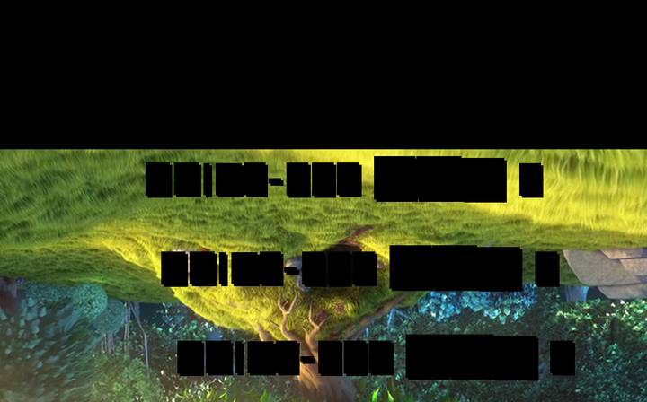

# SPIKE-002 · Android：Slint 视频表面与 libmpv

状态：**决定性问题已答，PASS**（本轮范围之外的项见文末）
对应 issue：[#9](https://github.com/kakakakacat/KiliKili/issues/9)
日期：2026-11-21
设备：小米 13 Ultra（2304FPN6DC）/ Android 14 / Adreno 740 / arm64-v8a，真机实跑

这份是**手写**记录，不是 `--record` 自动产出的那种（那条路是桌面实验台的，
Android 上没有命令行，入口是 `android_main`）。证据来自 logcat、mpv 自己的
日志、帧缓冲回读与系统截图。

## 本轮只问一个问题

> Android 上 Slint 的渲染回调给不给 OpenGL 上下文，libmpv 能不能把视频画进
> 同一个 framebuffer。

旋转、后台音频、PiP、Media3 回退对照**都不做**（2026-11-21 与所有者定的范围）。
原因是这一条是其余所有问题的前提：它若不成立，#9 的答案直接翻到
SurfaceView／纹理合成那条路，后面那些项要重新设计才谈得上。

桌面的结论不能直接推广，这正是本次要验的：**Android 上 Slint 用 skia，
不是桌面那条 femtovg**（slint 1.19 把 femtovg 挂在
`cfg(not(target_os = "android"))` 下），而 skia 有 OpenGL / wgpu / software
三种 surface，只有 OpenGL 那种会交出 `GraphicsAPI::NativeOpenGL`。

## 结论

| 问题 | 结果 | 证据 |
|---|---|---|
| Slint 的渲染回调给不给 GL 上下文 | **给** | logcat：`渲染回调给到 GraphicsAPI::NativeOpenGL` |
| 是真 GPU 还是软渲染 | **真 GPU** | `Qualcomm \| Adreno (TM) 740 \| OpenGL ES 3.2 V@0676.32` |
| mpv 的 render API 能否用 | **能** | `mpv render context 已建立` |
| mpv 能否画进 Slint 的 FBO | **能，画面正确** | 帧缓冲回读（下图）与系统截图一致 |
| Slint 的 UI 能否压在视频之上 | **能** | 同一张图里文本层在视频之上 |
| 能否避免每帧 CPU 拷贝（#9 标粗那条） | **能，但要两个前提** | `hwdec-current=mediacodec`（非 `-copy`） |



图是**进程内读回 FBO** 的结果（`glReadPixels`），不是系统截图——它量的是
「我们这一层画成了什么」，中间不隔 SurfaceFlinger。同一时刻的
`adb exec-out screencap` 与它一致，说明这一层的结果原样到了屏幕。

## 四个坑（Phase 2 的 Android 适配器会原样踩一遍）

### 1. 零拷贝要先把 JavaVM 交给 FFmpeg，而且退化是静默的

`hwdec=auto-safe` 实测落在 **`mediacodec-copy`** 上——每帧一趟
GPU→CPU→GPU，正是 #9 标粗要避免的那个拷贝。mpv 日志里的因果链：

```
h264_mediacodec: No Java virtual machine has been registered
h264_mediacodec: Both surface and native_window are NULL
Using hardware decoding (mediacodec-copy).
```

**`PlayerPort` 那一侧什么都看不到**：状态照样是 Playing，画面照样出来，只有
mpv 自己的日志里有这三行。所以适配器必须把 `hwdec-current` 读出来上报，
不能假定「要了什么就得到什么」。

两个前提缺一不可：

1. 进程启动时调用 `av_jni_set_java_vm`（符号在 libmpv.so 里，
   JavaVM 指针从 `AndroidApp::vm_as_ptr()` 拿）；
2. **显式要 `hwdec=mediacodec`**——`auto-safe` 不含非 copy 的那一档。

两条都做到之后 `hwdec-current=mediacodec`，mpv 走 `aimagereader` interop。

### 2. 画面是上下颠倒的，Android 要 `flip_y = true`

第一轮按桌面的参数传了 `flip_y = false`，回读出来天在下、地在上。
方向这件事**不能照抄桌面**，每个平台自己验一次。

### 3. Slint 按需重绘，mpv 不会自己出帧

mpv 只在 `BeforeRendering` 里画，而 Slint 没有「每帧都重绘」这回事：UI 不变
就不出帧。第一轮 HUD 每 200ms 更新一次，整条管线就被压到 5fps，看起来像是
mpv 不出帧——实际是没人驱动渲染。适配器必须自己有个帧泵（16ms tick，且
**让画面内容真的变**，否则 Slint 判不脏照样不画）。

### 4. 文本层在 Android 上没画对（本轮不展开）

回读图里能看到：弹幕文本只出现了**黑色方块**（缺字形的 tofu），HUD 面板与
水印**完全没出现**。桌面上这三样都正常。层级本身是对的（文本在视频之上，
这正是本轮要验的），但 Android 的字体与布局要单独查一轮——很可能是 Slint
在 Android 上没拿到系统字体（CJK 缺字形），HUD/水印那两处用的是
`parent.width/height` 定位，嫌疑另算。**不在本轮范围内**，记在这里，
做 Phase 2 的 Android UI 时第一个查它。

## 怎么复现

见 `spikes/slint-mpv/README.md` 的「Android（SPIKE-002 / issue #9）」一节：
取 libmpv.so（带 sha256）、`cargo apk run --release --lib`、`adb push` 媒体
文件、`adb logcat -s kk-spike`。

本机踩到的两件与探针无关的事，先写在这儿省得下一个人再查：

- **锁屏时启动的话什么都看不到**：activity 不可见 → Slint 不渲染 → 既没有
  日志也没有画面，而进程是活的，看起来像死锁。跑之前
  `adb shell svc power stayon usb`，跑完 `false` 还原。
- **logcat 的环形缓冲会把证据冲掉**：第一版把每条 mpv Snapshot（30ms 一条）
  都打出来，十几秒就把开头那几行结论挤没了。事件日志只记状态变化。

## 本轮没做的（#9 还开着的原因）

issue 列的 surface 生命周期、旋转、后台音频、PiP 可行性，以及 Media3
SurfaceView/TextureView 的回退对照，**一项都没做**。本轮把前提确认下来：
Slint + libmpv 这条路在 Android 上**走得通**，所以 Media3 回退对照从
「可能要换的主路」降级成「真要用到再说的备选」。
