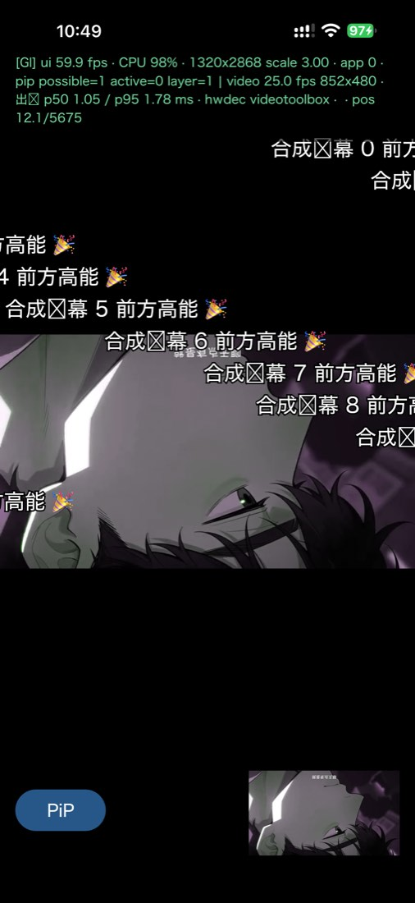
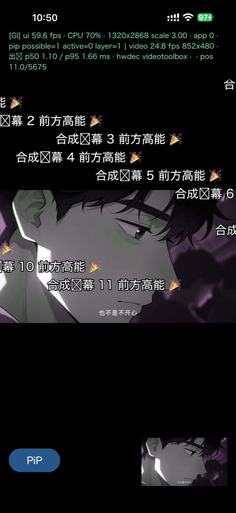
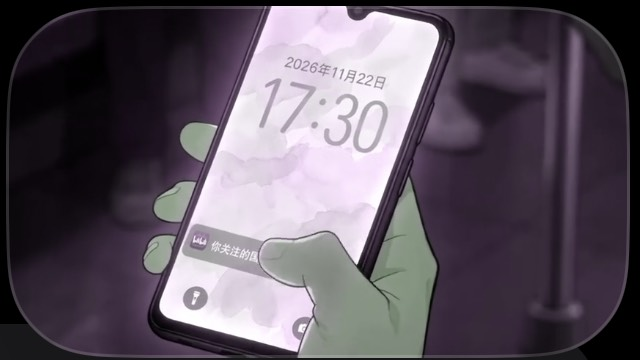
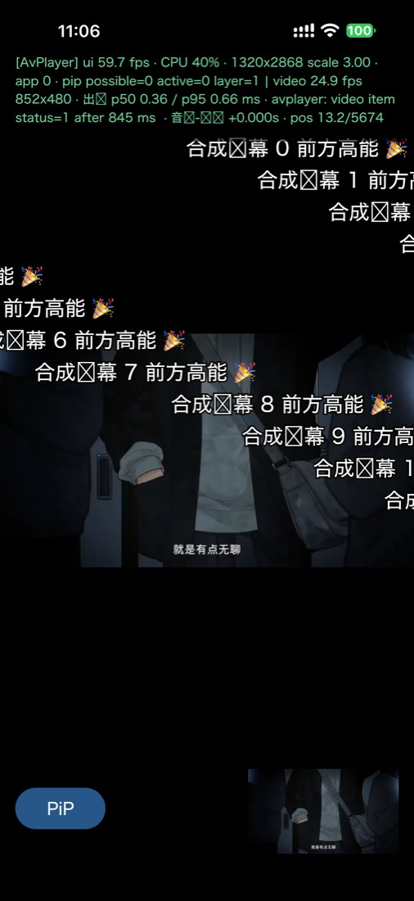

# SPIKE-004 · iOS：Slint + libmpv 零拷贝、PiP、后台音频与 AVPlayer 对照

状态：**#11 的范围已答，libmpv 路线可行（PASS）；AVPlayer 作为备选的代价比预想的小得多**
对应 issue：[#11](https://github.com/kakakakacat/KiliKili/issues/11)
日期：2026-11-24（第一阶段 2026-11-23）
设备：iPhone 16 Pro Max（iPhone17,2，A18 Pro）/ iOS 27.3，有线真机；Xcode 27.2，免费 Personal Team 签名
实验台：[`spikes/slint-ios`](../../../spikes/slint-ios)

这份是**手写**记录（同 SPIKE-002）：iOS 上没有命令行，入口是 `main.c` → Rust
的 `slint_ios_main`，证据来自 `devicectl --console` 收到的 `[spike]` 行、mpv 自己的
日志与系统截图。片源是一条公开视频的真实 DASH 取流（852x480 H.264 + AAC 分轨，
**未登录，最高 480p**），与 SPIKE-001/002 同一条。

## 0. 结论

1. **mpv 画面零拷贝进 Slint 可以走通，而且很便宜。** UI 稳在 60 fps，视频 25 fps
   满帧，UI 线程上每出一帧（mpv 渲染 + `glFlush`）p50 1.26ms、p95 < 2ms，
   `hwdec-current=videotoolbox`（不是 `-copy`）。相比第一阶段的软件渲染基线
   （一帧 38ms、UI 掉到 6 fps）是两个数量级。
2. **PiP 可行**：AVSampleBufferDisplayLayer + `AVPictureInPictureController(contentSource:)`，
   上滑回桌面自动进小窗，小窗里视频持续 25 fps，进程 CPU 12%。
3. **后台音频可行，但有一个必须写进 Phase 2 的坑**：没进 PiP 的情况下退到后台，
   iOS 会让 VideoToolbox 会话失效，mpv 一次性退回软解、卡 3–4 秒、**回前台也
   不会切回硬解**。第一阶段记的「退后台停 2–3 秒」就是它。修法是进后台前
   `vid=no`、回前台 `vid=auto`——不卡、后台 CPU 3%、回来重新硬解。
4. **AVPlayer 不需要本地代理，也不需要转封装**：B 站 m4s 自带 sidx，读开头 32KB 就能
   生成一份字节范围寻址的 fMP4 HLS 播放列表，用 AVAssetResourceLoader 供给，
   0.85 秒起播，CPU 比 mpv 低 4 个点，PiP 同样可行。直接把 m4s 交给 AVPlayer
   则要 46 秒才能起播——「AVPlayer 不支持分轨 DASH」这句话的真实代价是这个，
   不是转码。
5. **iOS 上 FBO 不翻转**——和 Windows / Android / macOS 三端相反（§2.2）。
   Phase 2 的适配器需要按平台给 `flip_y` 默认值，SPIKE-001 notes 里「三端一致、
   不必分支」那句对 iOS 不成立。

## 1. 一张表看完

| #11 的项 | 结果 | 证据 |
|---|---|---|
| libmpv 在 iOS 的构建 | **现成可用**：media_kit 带的 mpv 0.39 xcframework 直接链 | 编进了 `gl`/`ios-gl` + videotoolbox + audiounit；无 Vulkan、无 avfoundation VO |
| Slint 在 iOS 上的渲染后端 | 开 `unstable-wgpu-30` 后是 **Skia on wgpu（Metal）** | `rendering setup: GraphicsAPI::WGPU30`；第一阶段（未开该 feature）是 femtovg-wgpu |
| 原生表面集成（零拷贝） | **PASS** | `zero-copy targets ready: 3 × 852x480`，60 fps / 25 fps，见 §2 |
| 硬解是否零拷贝 | **是** | `hwdec-current=videotoolbox` |
| PiP | **PASS**（mpv 与 AVPlayer 两条路都过） | `pip didStart`、`app state → 2 · pip_active=true`、小窗截图 |
| PiP 期间后台 GLES 渲染 | **没被系统杀**，30+ 秒持续 25 fps | 见 §3.2 |
| 后台音频 | **PASS**（带 §4 的修法） | 后台 15 秒 `time-pos` 11.0 → 26.1 连续走；会话 `Playback`/`MoviePlayback` |
| AVPlayer 播 B 站分轨 DASH | 直接放：**46 秒才起播**；转字节范围 HLS：**0.85 秒** | §5 |

## 2. 零拷贝路线

### 2.1 链路

```
mpv (OpenGL ES 3, hwdec=videotoolbox)
  └─ 画进 FBO ── GL 纹理 ←─ CVOpenGLESTextureCache ─┐
                                                    ├─ 同一块 IOSurface（CVPixelBuffer, BGRA）
Slint (Skia on wgpu/Metal)                          │
  └─ 采样 wgpu::Texture ← MTLTexture(RGBA8 + 交换 R/B 的 swizzle 视图) ─┘
PiP (AVSampleBufferDisplayLayer) ←── 同一张 CVPixelBuffer 包成 CMSampleBuffer
```

- GLES 侧：`EAGLContext(GLES3)` 当前化后建 mpv 的 `MPV_RENDER_API_TYPE_OPENGL`
  （`get_proc_address` 走 `dlsym`），ios-gl 的 hwdec 互操作在这时绑定上下文。
- Metal 侧：从 Slint 的 `GraphicsAPI::WGPU30 { device, .. }` 经 `as_hal::<Metal>()`
  取出 MTLDevice，在同一块 IOSurface 上建纹理，再用 wgpu-hal 的
  `texture_from_raw` + `create_texture_from_hal` 包成 `wgpu::Texture`，
  `slint::Image::try_from` 交给 Slint。
- 三张目标轮转，避免 mpv 写的同时 Slint / PiP 正在读。
- `MPV_RENDER_PARAM_BLOCK_FOR_TARGET_TIME = 0`，理由同 Windows 那次（不关的话
  UI 线程被锁在视频帧率上）。

### 2.2 方向：iOS 上**不要** flip_y



`flip_y=1`（照搬三端的结论）时字幕倒立、跑到画面顶部；`flip_y=0` 才对：



原因：那三端是 femtovg 在 **GL 里**采样 GL 纹理，两边都按左下原点；这里是
**Metal** 采样 IOSurface，Metal 按左上原点，mpv 的「画进 FBO 要翻一下」被
抵消了。截图右下角的 160×90 小图是 PiP 的源层，吃的是同一张 CVPixelBuffer，
方向与主画面一致，说明内存里的像素本身就是正的。

### 2.3 一个只在 Skia 下暴露的坑：格式

`Image::try_from(wgpu::Texture)` 只收 `Rgba8Unorm`，而 CoreVideo / GLES 的
IOSurface 只有 BGRA。第一版用 CVMetalTextureCache 出 BGRA8Unorm、对 wgpu 谎报
成 Rgba8Unorm——femtovg 不验格式，能过；但 **Slint 一开 `unstable-wgpu-30`
就改选了 Skia 渲染器**，Skia 的 `Image::from_texture` 发现格式不符返回空，
Slint 里一个 `unwrap()` 让进程直接 abort：

```
panicked at i-slint-renderer-skia-1.19.0/wgpu_30_surface/metal.rs:100:14:
called `Option::unwrap()` on a `None` value
```

现在的做法：在同一块 IOSurface 上建一张**真正的** `RGBA8Unorm` 纹理（按 RGBA
解读 BGRA 字节，R/B 是反的），再建一个 B↔R 互换的 swizzle 视图。格式真实、
两种渲染器都吃，颜色对，仍然零拷贝。Phase 2 的适配器照这个写，不要用谎报。

### 2.4 数字（稳态，第 45–75 秒）

| 模式 | UI fps | 进程 CPU | 每帧占 UI 线程 | hwdec |
|---|---|---|---|---|
| 无视频（只有 Slint + 12 条合成弹幕） | 60.0 | 31% | — | — |
| **mpv GL 零拷贝** | 60.0 | **43%** | p50 1.26 / p95 1.93 ms | `videotoolbox` |
| mpv GL，`videotoolbox-copy` | 60.0 | 44% | p50 1.60 / p95 2.32 ms | `videotoolbox-copy` |
| mpv GL，`glFinish` 代替 `glFlush` | 59.9 | — | p50 2.38 / p95 4.21 ms | `videotoolbox` |
| AVPlayer（HLS，见 §5） | 60.0 | **39%** | p50 0.37 / p95 0.84 ms（只是导入纹理） | 系统 |
| 第一阶段：mpv 软件渲染 | **6.2** | 61% | p50 38.7 ms | `videotoolbox-copy` |

读法：

- 在 480p 下 `-copy` 与零拷贝只差 0.3ms 和 1 个点 CPU——片源太小，拷贝不贵。
  1080p/4K 下差距会放大，但没量（未登录拿不到）。
- `glFlush` 就够：同一 GPU 上的 IOSurface 由驱动做跨 API 同步，截图里没看到
  撕裂或旧帧；`glFinish` 只是让 UI 线程多等 1ms。
- **mpv 的前 20–25 秒 CPU 偏高**（均 55%，峰值 80–110%），之后才稳在 43%。
  同一时段 AVPlayer 稳在 37%。看起来是 mpv 的网络缓存在全速拉流（TLS 是
  mbedtls 软算），不是渲染：出帧耗时那段时间并没有变。Phase 2 若在意发热，
  要调 `demuxer-max-bytes` / `cache-secs`，没在这一轮里验证。
- 无视频那一行 31% 本身就不低：60 fps 重绘 12 条描边文字 + 8ms 的定时器。
  这是实验台的开销，不是播放器的。

## 3. PiP

### 3.1 做法

AVSampleBufferDisplayLayer 挂进窗口的视图树（160×90 的缩略图——PiP 要求源层
可见），每画一帧就把那张 CVPixelBuffer 包成 CMSampleBuffer（`DisplayImmediately`）
送进去；`AVPictureInPictureController(contentSource:)` 配一个实现
`AVPictureInPictureSampleBufferPlaybackDelegate` 的对象，打开
`canStartPictureInPictureAutomaticallyFromInline`。

测法不靠人手：播放 12 秒后用 `devicectl device process launch com.apple.Preferences`
把「设置」顶到前台，实验台随之退后台——和用户上滑回桌面走的是同一条路。

```
app state → 1 · pip_active=false
pip willStart
pip renderSize 208x117
pip didStart
app state → 2 · pip_active=true
[Gl] ui 0.0 fps · CPU 12% · app 2 · pip possible=1 active=1 | video 24.9 fps · hwdec videotoolbox
```



### 3.2 PiP 期间 GLES 在后台画——这次没被杀

Apple 的文档一直说后台的 App 不许提交 OpenGL ES 命令，违者被
`gpus_ReturnNotPermittedKillClient` 杀掉。这次 PiP 期间在后台持续 GLES 渲染
30 多秒，没被杀；连**不开 PiP、强制在后台画**（`SPIKE_BG_RENDER=1`）也没被杀。
推测是 iOS 27 的 GLES 已经跑在 Metal 之上（`OpenGL ES 3.0 Metal - 105`），
那条限制实际上松了。

**这只是观察，不能当保证**：文档没改，换个系统版本可能又会杀。Phase 2 里
「后台、未进 PiP」时一律不画（实验台默认如此），PiP 期间画是唯一的办法——
mpv 在 iOS 上没有别的渲染出口。若将来真的被禁，退路是 PiP 期间切到 AVPlayer
那条（§5），它不碰 GL。

### 3.3 没验到的

- PiP 小窗里的播放/暂停按钮、从小窗点回 App 的恢复：代码接好了
  （`setPlaying:` → mpv 的 `pause`），但没人去点。
- PiP 的进度条：`timeRangeForPlayback` 按 mpv 的 `time-pos`/`duration` 给，没看
  显示得对不对。

## 4. 后台音频与 VideoToolbox 会话

### 4.1 问题

不开 PiP、退到后台（`SPIKE_PIP=0 SPIKE_BG_VIDNO=0`）：

```
app state → 2 · pip_active=false
[ffmpeg/video] h264: Failed to decode frame (invalid session, -12903)
Attempting next decoding method after failure of h264-videotoolbox.
… pos 11.6 → 11.6 → 11.6 → 11.6 → 15.8      ← 卡了约 4 秒
… hwdec no · CPU 52–60%                    ← 后台软解
app state → 0
… hwdec no · 出帧 p50 1.8 ms · CPU 47–50%   ← 回到前台，仍是软解
```

`-12903` 是 `kVTInvalidSessionErr`：退后台时系统收回了 VideoToolbox 会话。mpv
的反应是**永久**退回软解（它不会自己再试硬解），于是三件事一起发生：切换那一下
卡几秒、后台白白软解视频（480p 就吃掉半个核）、回前台以后一直是软解。
第一阶段「退后台停 2–3 秒」的根因就是这个，不是音频会话。

PiP 期间没有这个问题——`hwdec` 一直是 `videotoolbox`。

### 4.2 修法

进后台（且没进 PiP）前把视频轨关掉，回前台再打开：

```
app state → 1 · pip_active=false
vid → no (Ok(()))
… pos 11.0 → 12.0 → 13.0 → … → 26.1        ← 不卡
… CPU 2–3%                                 ← 只解音频
app state → 0
vid → auto (Ok(()))
… hwdec videotoolbox                       ← 新的 VT 会话
```

细节：要在状态 1（过渡）就关，赶在会话失效之前；但 PiP 是在过渡期间才启动的，
所以装了 PiP 时要等到状态 2、确认没进 PiP 再关。Phase 2 的 iOS 适配器要把
这条做进生命周期处理，`vid` 的开关是 mpv 侧的，不涉及 Rust 业务层。

### 4.3 声音

mpv 自己把会话设成 `Playback` + `MoviePlayback`（第一阶段仓库所有者已在前台
听到声音）。后台这一轮的证据是 `time-pos` 持续前进、
会话类别不变；**后台是否真的一直有声，这一轮没人用耳朵确认**。

AVPlayer 不会替你设会话：默认 `SoloAmbient` 下 `isPictureInPicturePossible`
恒为 NO（实测 `possible=0`），设成 `Playback` 之后才变成 1。

## 5. AVPlayer 对照组

同一个 App 里做（免费签名一台设备最多 3 个 App，没有再装一个探针），
`SPIKE_MODE=avplayer`。画面走 `AVPlayerItemVideoOutput`（BGRA、Metal 兼容），
进 Slint 用的是 §2 的同一个导入函数——所以弹幕叠加、PiP 的做法与 mpv 路线完全一样。

### 5.1 三种喂法

| 喂法 | 结果 |
|---|---|
| 直接给 m4s 地址 | **`-11828 This media format is not supported`**。CDN 回 `Content-Type: application/octet-stream`、扩展名 `.m4s`，AVFoundation 两样都认不出 |
| 加 `AVURLAssetOverrideMIMETypeKey`（iOS 17+，公开 API）＝`video/mp4`/`audio/mp4` | **认得了，但极慢**：拼 `AVMutableComposition` 要先 `loadTracks`，35 秒没返回；改成视频、音频两个 AVPlayer 各放各的，音频约 20 秒、视频 **46 秒**才 `readyToPlay`，而且两个播放器之间的同步要自己做 |
| **生成字节范围 HLS**（下面） | **0.85 秒 `readyToPlay`**，一个 AVPlayer 播音视频，同步交给系统 |

慢的原因：这些是 300MB 级的 fragmented MP4，`moov` 里没有样本表，AVFoundation
看起来要把分片挨个扫一遍才肯起播；它不看 sidx。

### 5.2 DASH → HLS：不转码、不代理

每路 m4s 开头都是 `ftyp` + `moov` + `sidx`（实测 init 段 915 字节、sidx 13.8KB），
playurl 响应的 `segment_base` 也直接给了 `initialization` / `index_range`。sidx 里
有每个分片的字节长度与时长，于是：

```
#EXTM3U
#EXT-X-VERSION:7
#EXT-X-TARGETDURATION:6
#EXT-X-PLAYLIST-TYPE:VOD
#EXT-X-MAP:URI="<原始 m4s 地址>",BYTERANGE="915@0"
#EXTINF:5.005,
#EXT-X-BYTERANGE:<长度>@<偏移>
<原始 m4s 地址>
…
#EXT-X-ENDLIST
```

视频、音频各一份媒体列表，再加一份 master（`EXT-X-MEDIA:TYPE=AUDIO` 音频组）。
三份列表用自定义 scheme 交给 `AVAssetResourceLoader` 供给；**分片地址就是原始
https 地址**，AVPlayer 自己发 Range 请求去 CDN，不经过 App，不起本地 HTTP 服务。

实测：两份列表各约 0.9MB（一千一百多个分片），读开头 + 生成 228ms，0.85 秒
`readyToPlay`，25 fps，稳态 CPU 39%，PiP 期间 7%。



### 5.3 这条路的代价与风险

- **请求头**：B 站要 Referer。AVURLAsset 没有公开的设头参数，这里用的是社区
  通用的私有键 `AVURLAssetHTTPHeaderFieldsKey`——能用，但上架审核有风险。
  公开的替代是让分片也走 resource loader（App 自己发请求再回填数据），那就
  回到了「本地代理」的工作量和一次内存拷贝。没验证 CDN 不带 Referer 时
  是否放行。
- **列表生成算法属于 Rust**：sidx 解析、分片表、master 的拼法都是「协议没规定、
  两端必须一致」的东西，按 AGENTS.md §2 应放在 `bili-core`，宿主只负责把字符串
  交给 resource loader。实验台写在 ObjC 里只是为了快。
- **没测**：Seek、倍速、切清晰度（换一组 master 即可，没验）、HEVC/AV1
  （`CODECS` 要按流填对，否则 AVPlayer 拒播）、杜比视界、地址过期后的续播
  （地址约 2 小时过期，列表里写死了地址）。
- 包体：mpv 路线要带 21MB 的 framework（实验台 App 39MB 里的 21MB），AVPlayer 是 0。

## 6. 对 ADR-004 的意义

- **iOS 上 libmpv 不再是「能不能」的问题。** 零拷贝合成、PiP、后台音频都有了
  可工作的做法，代价是两条平台特有的胶水（§2.3 的格式、§4.2 的 `vid` 开关）
  和一个 OpenGL ES 已废弃的长期风险（mpv 0.39 在 iOS 上只有 GLES 渲染接口）。
- **AVPlayer 作为备选的成本被高估了。** RFC 里写的「HLS 转换/本地代理」实际上
  是「解析 sidx 生成文本」，不需要转码、不需要代理进程，起播更快、CPU 更低。
  它的硬伤在别处：私有的设头键、HEVC/AV1/DV 的覆盖、以及和其他四端 mpv
  行为对齐（弹幕时钟、倍速、字幕）的长期成本。
- **两条路共用同一个「CVPixelBuffer → Slint」导入**，所以 Phase 2 不必一开始就
  定死：先上 mpv（与其他四端一致），把 AVPlayer 留作 iOS 上 GLES 被真正拿掉时
  的退路，代价已经量过了。

## 7. 没覆盖的

- 只到 480p（未登录）；1080p/4K、HEVC、AV1 都没量。
- 内存/RSS 没量；电量与发热没量（只看了 CPU）。
- 旋转、安全区（RFC §7.2 的 iOS 项，不在 #11 的范围里）。
- 中文字体是方块，单开了 #206（截图里的 ☒ 就是它）。
- 120Hz：UI 封顶 60 fps，Info.plist 的 `CADisableMinimumFrameDurationOnPhone` 没试。
